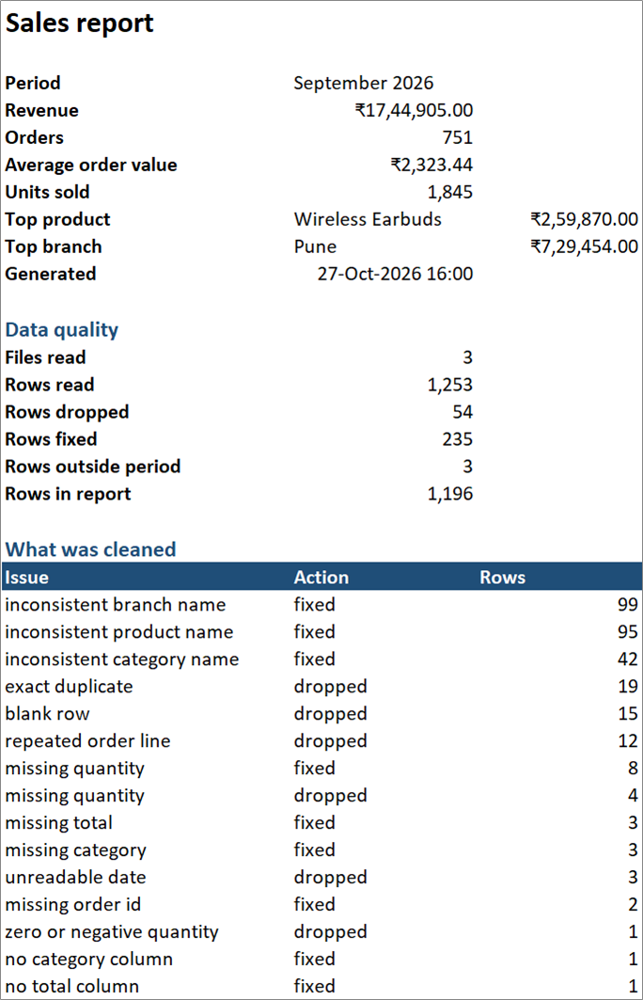
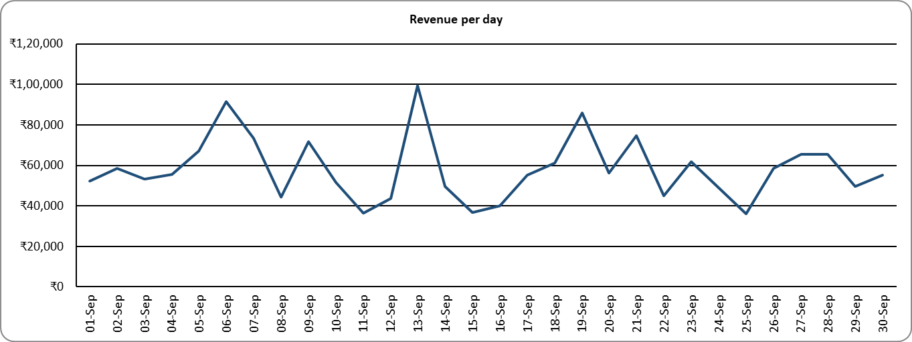
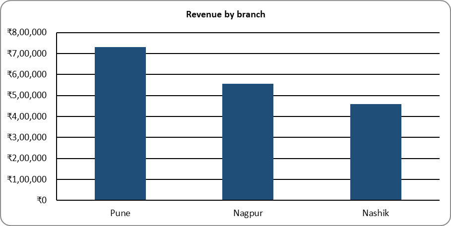

# excel-report-automation


Turns a folder of messy sales exports (CSV and Excel, from different billing systems) into one clean Excel report with totals, charts and a list of every row that was fixed or dropped.

**The typical client request:** "Each of our branches sends its monthly sales in a different format. Someone spends two days copying it all into one sheet, fixing dates and deleting duplicates before we can even see the totals. Can you automate this?"

**What you get:** put the month's files in a folder and run one command. About a second later there's a formatted Excel report with revenue, orders and best sellers by branch, category and day. A Data Issues sheet lists each row that was dropped or fixed and why, so the owner can check the numbers instead of taking them on trust.

| | |
|---|---|
| Sample input | 3 files (2 CSV, 1 XLSX) in three different layouts, 1,253 rows |
| Cleaning | 54 rows dropped (blank, duplicate, impossible date, no quantity), 235 rows fixed |
| Runtime | about 1 second, including Python start-up (0.3s for the actual work) |
| Output | one `.xlsx` with 7 sheets and 4 native Excel charts |

The Summary sheet for the sample data, and two of the charts, as Excel shows them:







## The sample data

`samples/make_messy_data.py` generates September 2026 sales for a fictional chain of mobile and computer accessory shops in Pune, Nashik and Nagpur. Each branch uses different billing software, so each file is messy in its own way:

| File | Problems |
|---|---|
| `pune_pos_export.csv` | `Bill No` / `Item Name` / `Rate` headers, dd/mm/yyyy dates, prices like `₹1,234.50` and `₹ 899`, no amount column, a few rows with no quantity or `2 pcs`, two rows dated 31/09/2026 |
| `nashik_billing.csv` | `Invoice Number` / `Net Amount` headers, dates as `2026-09-03` or `3 Sep 2026`, money as `Rs 1234`, `Rs. 1,234.00` or `1234/-`, no category column, a second export of a few invoices pasted underneath with different formatting |
| `nagpur_sales.xlsx` | a title line above the header, real Excel dates mixed with text dates, three late entries from August, some missing order IDs, units and totals |

All three have blank rows, exact duplicate rows, and stray spaces and random casing in branch, product and category names (`" PUNE"`, `"usb-c cable 1m"`). The generator is seeded, so it writes the same files every time. They're committed in `data/raw/`.

## How it works

1. **Load:** reads every `.csv` and `.xlsx` in the folder. It finds the header row even when there's a title above it, and remembers which file and row each line came from.
2. **Map columns:** `Bill No`, `Invoice Number` and `Order ID` all become `order_id`; `Rate`, `Price` and `Unit Price (INR)` become `unit_price`, and so on (see `COLUMN_ALIASES` in `clean.py`). Columns it doesn't need, like `GST %`, are ignored.
3. **Clean:**
   - dates in any of the usual formats, day-first by default (`03/09/2026` is 3 September). Impossible dates like 31 September are dropped, not guessed.
   - money and quantities: `₹1,234.50`, `Rs. 1,234`, `INR 1,23,456.00`, `1234/-`, `2 pcs`
   - names: extra spaces removed, and each name is spelled the way it's spelled most often in the data. `PUNE` and ` pune` become `Pune`, while `USB-C Cable` keeps its capitals.
   - a missing quantity is worked out from total / unit price, a missing total from quantity x unit price, a missing category from the same product elsewhere in the data
4. **De-duplicate:** drops blank rows, exact duplicates, and repeats of the same order line (same branch, order ID and product), even when the copy is formatted differently.
5. **Report:** writes the Excel file with openpyxl.

Every dropped or changed row goes into the Data Issues sheet with its file, row number and the reason, for example `same order and product as nashik_billing.csv row 6` or `'USB-C CABLE 1M' -> 'USB-C Cable 1m'`.

## The report

| Sheet | Contents |
|---|---|
| Summary | revenue, orders, average order value, units sold, top product and branch, period and when it was generated. Below that: rows read, dropped and fixed, a count of each kind of problem, and rows per source file. |
| By Branch | orders, units, revenue, share and average order value per branch, with a bar chart |
| By Category | the same per category, with a bar chart |
| Daily | every day of the period, including days with no sales, with a line chart |
| Top Products | the 10 best sellers by revenue, with a bar chart |
| Clean Data | every cleaned row with its source file and row number, filters on |
| Data Issues | what was dropped or fixed, and why |

Money cells hold real numbers with a currency format (`"₹"#,##0.00`), so they still add up and sort in Excel. On a machine set to Indian English, Excel shows them with lakh grouping (₹17,44,905.00). Header rows are frozen and columns are sized to fit.

## Setup

```
pip install -r requirements.txt
```

## Usage

```
# rebuild the sample files (optional, they're already in data/raw)
python samples/make_messy_data.py

# report on everything in the folder
python build_report.py data/raw/ -o output/report.xlsx

# September only; the three late August rows are left out
python build_report.py data/raw/ -o output/september.xlsx --month 2026-09

# US-style dates (09/03/2026 = 3 September) and a different currency symbol
python build_report.py exports/ -o output/report.xlsx --month-first --currency "$"

# email the finished report
python build_report.py data/raw/ --month 2026-09 --email owner@example.com
```

The September run on the sample data:

```
15:23:31 nagpur_sales.xlsx: 399 rows, header on row 3
15:23:31 nashik_billing.csv: ignoring columns GST %
15:23:31 nashik_billing.csv: 344 rows, header on row 1
15:23:31 pune_pos_export.csv: 510 rows, header on row 1
15:23:31 read 1253 rows from 3 files: 54 dropped, 235 fixed
15:23:31 3 rows fall outside 2026-09, 1196 left for the report
15:23:31 saved output\september.xlsx in 0.3s
```

Run `python build_report.py -h` for all options.

### Email

`--email` sends the report as an attachment, with the headline numbers in the message body. Copy `.env.example` to `.env` and fill in `SMTP_USER` and `SMTP_PASSWORD` (for Gmail, create an App Password). If they aren't set, the report is still written and the email step is skipped with a warning.

To get the report every month without anyone running it, schedule the command with Task Scheduler on Windows or cron on Linux.

## Tests

```
python -m pytest
```

The tests cover column mapping, number and date parsing edge cases, duplicate counts, the month filter, that every sheet and chart is there, and that the totals on every sheet match the clean data. Email is tested against a fake SMTP server, so nothing gets sent.

## Adapting it to a client's data

- **Different column names:** add them to `COLUMN_ALIASES` in `clean.py`. If a file is missing a column the report needs, the run stops and prints the headers it found.
- **What counts as a duplicate:** `LINE_KEY` in `clean.py`. The default (branch + order ID + product) suits bill exports with one line per product. If each row is a whole order, set it to `ORDER_KEY`.
- **Dates:** day-first unless you pass `--month-first`. If a date only makes sense the other way round (like `09/13/2026`), its Data Issues entry says so.
- **More breakdowns:** add the column to `STANDARD_COLUMNS` and `COLUMN_ALIASES`, then a "By Salesperson" sheet is a `breakdown(df, "salesperson")` and a `write_table` call in `report.py`.
- Only the first sheet of each workbook is read. Returns (zero or negative quantities) are dropped and logged; if the client wants them netted off, change that check in `clean()`.
- Text in the input that starts with `=` is written to the report as plain text, never as a live formula.

## License

MIT
